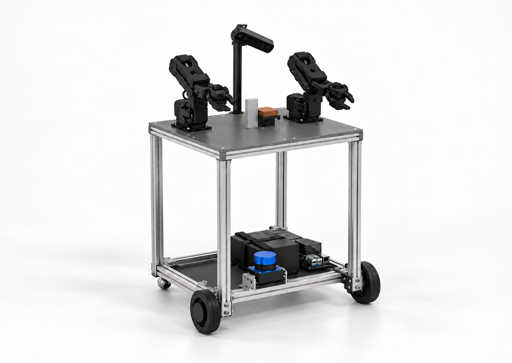

# HOLD THE FLOW · 이동형 양팔 물 서빙 로봇

웹에서 테이블의 물 주문을 받아 주방에서 물을 따르고, 컵을 상판에 싣고 이동해
테이블에 놓은 뒤 도크로 복귀하는 로봇이다. 동국대 DAPIER 피지컬 AI 부트캠프
MS Team의 공용 저장소이며, 이동·양팔 조작·관제를 하나의 주문으로 연결한다.

시뮬레이션의 전체 미션, 실차의 서비스 이동, 양팔 조작을 각각 시험했다.
실물에서 주문부터 물 서빙·충전까지 이어지는 전체 미션의 반복 검증은 남아 있다.

<p align="center">
  
</p>

그림은 부품 배치를 설명하는 콘셉트다. 제작·충돌·관성 검토에는
[축척 모델](docs/assets/full_size_frame_20260910/model_overview.png)과 기구 사양을 사용한다.
실제 조립·센서 배치와 모델의 차이는 아래 하드웨어 항목에서 구분한다.

## 현재 구현과 검증 범위

| 영역 | 확인된 상태 | 남은 검증 |
|---|---|---|
| 웹 주문·관제 | 4테이블·냉수/온수 선택, 주문 큐, 배터리 분기, SQLite 복구, Action 결과 대기 | 물리 미션의 반복 주문·재시작 복구, 실제 배터리·충전 신호 연결 |
| Isaac 전체 미션 | 도크 출발·양팔 물붓기·상판 운반·재파지·테이블 배치·도크 복귀 1회 통과 | 현행 순정 왼손으로 전체 미션 재시험, 물체 인식 입력, 충전 물리 |
| 순정 왼손 접촉 | 10 g·등가 질량 210 g 강체 컵의 파지·상승·놓기·손 분리 시험 통과 | 컵 변형·물 유동·이동 중 운반·실물 파지 |
| JD-AMR 실차 이동 | 4WD 차체의 수동·자동 후진, 회전, 책상 접근 수행. 1 cm 정밀주차 성공을 사용자가 확인했으며 후면 하단 박스는 라이다로 관측 | 반복 정밀도, 팔 작업 완료 신호 연결, 적재 하중을 포함한 전체 미션 시험 |
| 실물 왼팔 IK | 상대 DLS IK·엔코더 피드백으로 컵 동반 상승을 관찰한 기록 | 현행 양팔 보정으로 계획 재생성, 책상 완전 분리·TCP 정밀도·운반·놓기 |
| SmolVLA 조작 | 정책 파트에서 40개 에피소드 학습 정책의 주방 조작 1회 완주 보고 | checkpoint·영상·보정·데이터 원본 연결, 공통 조건 반복 평가 |
| 물체·물 양 인식 | 컵 검출·평면 변환·IK 도구, 액면·흘림 판정 설계 | 실물 카메라 보정, 컵별 mL 보정표, 붓기 정지 연동 |
| 모델 | 58링크·57관절의 URDF/Xacro와 CAD, 정적 계약 검사 | 실측 장착 좌표·접촉·관성·구동 추종의 일치 |

시뮬 성공, 팀 보고, 실물 관측을 같은 성과로 합산하지 않는다. 전체 미션 시뮬은
구형 강체 패드와 정답 물체 좌표를 사용했고, 실차 이동에서는 팔 작업을 대기로 대체했다.
실물 IK의 컵 동반 상승도 전체 픽앤플레이스 완료를 뜻하지 않는다.
실험 조건·원본 위치·변경 이력은 [진행 로그](PROGRESS.md)에 기록한다.

<!-- AUTO:PROJECT-STATUS:START -->
## 단일 원본 자동 요약

> 아래 표는 기계 YAML에서 생성한다. 수정하려면 표가 아니라 연결된 원본 파일을 고친다.

| 항목 | 현행 값 |
|---|---|
| 기계 개정 | `2026-10-14_final_four_wheel_drive_selected` |
| 상·하부 프레임 | 450×340 mm |
| 상판 높이 | 720 mm |
| 왼손 | SO-101 순정 회전식 죠, TPU·오버캡 없음 |
| 오른손 | `ggao50_SO101_Parallel_Gripper` |
| RGB-D | Orbbec_Astra_S, 상판 위 540 mm |
| 베이스 | skid_steer_four_wheel_drive, Feetech_STS3215_C018_12V |
| 모델 상태 | `simulation_model_ready_physical_measurements_pending` |

원본: [`hold_flow_mechanical_v0_3.yaml`](design/mechanical/hold_flow_mechanical_v0_3.yaml)
과거 후보: [`finray_80mm_lip3_selection.yaml`](design/gripper/finray_80mm_lip3_selection.yaml)
<!-- AUTO:PROJECT-STATUS:END -->

4륜 스키드스티어를 최종 구동안으로 선택했다. 기계 YAML·URDF·Isaac 구동 계약·프리뷰는
네 구동륜과 캐스터 없는 구성으로 맞췄다. 기존 전륜 실측 간격510 mm와 앞끝에서 축까지
65 mm를 반영했고, 후륜 대칭 장착은 사용자 확인을 반영했으며 축간210 mm는 기존 전륜 실측에서 환산한 값이다. 상판 높이·센서
장착 좌표는 기존 명목 모델이며 높아진 실차 구조와의 일치는 재측정 뒤 반영한다.

## 미션과 MVP 범위

```text
도크 대기 → 테이블 물 주문 → 주방 이동·정렬·정차
  → 왼팔 컵 파지 + 오른팔 물통 파지 → 물붓기·물 양 확인
  → 물통 반환 → 컵 상판 적재·손 분리 → 테이블 이동·정차
  → 컵 재파지·테이블 배치·손 분리 → 도크 복귀
```

컵은 양팔 사이 상판에 놓고 운반한다. 주행 중 팔로 컵을 들지 않으며,
파지·붓기·놓기 전에 베이스를 정지한다. 도크 도착과 실제 충전 시작은 별도로 판정한다.

초기 실물 통합 범위는 등록한 작업대·한 종류의 컵과 물통·상온의 물·한 테이블이다.
웹의 4테이블·냉수/온수 선택 기능이 모든 조합의 물리 검증 완료를 뜻하지 않는다.
온수 조작, 다중 로봇 배차, 사람과 함께 쓰는 매장 상시 운용, 범용 조립·음성 태스크는
MVP에서 제외한다. 태스크 결정 원본은 [회의 결정과 실행 범위](docs/meetings/20260907_물서빙로봇_회의결정과_실행범위.md)다.

## 하드웨어와 모델

- 프레임: 상·하부 450×340 mm, 프로파일 기둥 4개, 4분할 프린팅 상판.
  상판 높이 720 mm, 바퀴 포함 폭 540 mm가 제작 기준이다.
- 양팔: SO-101 두 대. 왼손은 순정 회전식 죠를 사용하며 TPU·오버캡을 붙이지 않는다.
  오른손은 ggao50 순정 평면 죠이며 홈·교체형 인서트를 사용하지 않는다.
- 실물 조작 관제: 상단 RGB 1대와 손목 RGB 2대. 설계의 Astra S RGB-D와 구분한다.
  카메라 연결 확인은 영상 좌표와 팔 좌표의 보정 완료가 아니다.
- 실차 주행: Raspberry Pi 4B 4GB, ESP32, Astra(`2bc5:0401`)와 YDLIDAR G4.
  카메라는 기존 Astra S에서 교체됐으며 양팔 조작에 쓰는 설치 각도를 유지한다. 기존 장착 모델은 상판
  뒤끝에서 렌즈 중심이 상판 윗면보다 540 mm 위에 있고 아래를 본다. 이 상대 높이는 사용자
  확인값이고 상판 윗면의 바닥 기준720 mm도 사용자 확인했다. 교체 후 실제 높이·각도 보정은 미완료다. LiDAR 위치는 유지했고,
  후륜은 앞뒤 끝에서 같은 거리로 장착했다는 사용자 확인을 반영한다.
  라이다 방향은 같은 후면 박스의 좌우 실측 간격으로 임시 보정하며, 기둥 자기반사 필터는
  센서 좌표계에 고정해 보정 전후 동일한 반사점만 제거한다.
- 4WD 제어: ESP32가 같은 측 앞뒤 모터 속도를 `SYNCWRITE`로 보내고 네 엔코더를
  따로 읽어 측면 평균을 계산한다. 기존 protocol v2와 Pi 40핀 UART 운영을 유지한다.
  접촉센서는 5 V와 GND만 연결돼 신호 입력은 아직 없다.
- 모델: URDF는4개 구동륜과 캐스터 없는 최종안을 사용한다. 축간210 mm는 사용자 대칭 장착 확인의 환산값이며, 적재 상태 유효 트레드는
  미측정이다. 카메라 z는 확인된 상판720 mm에 상대 높이540 mm를 더한1260 mm다.
  설계 모델의 기존 x와35° 하향 자세는 유지하며, 실차 주행 모델의 별도 장착각과 혼용하지 않는다.
  LDS-03 센서 프록시도 실차 G4와의 차이를 남기고 모델 좌표를 실차 TF에 자동 적용하지 않는다.
- 질량·하중: URDF 명목 빈 질량은 7.479 kg. 추가 적재 5 kg의 수동 평지 주행은
  예비 시험이며 정격 적재량·실측 총질량·연속 운전 성능으로 사용하지 않는다.

캘리브레이션은 [양팔 JSON과 보정 상태](calibration/README.md)로 관리한다.
현행 양팔 follower와 오른쪽 leader는 팀원의 그리퍼 재조립 후 새 보정을 반영한다.
양팔 실행은 `calibration/bi_follower`·`bi_leader`를 사용하며 단일팔 과거 사본을 섞지 않는다.
이전 IK 관측은 교체 전 보정의 시험 기록이다. 이전 정책의 수집 보정과 호환은 별도
확인하며, 보정 변경 뒤 이전 raw 목표·IK mapping·계획 packet을 그대로 재사용하지 않는다.
영점·TCP·개구 대응과 실물 정밀도는 캘리브레이션 파일 저장 여부와 구분한다.

기구·CAD·모델 생성과 검증은 [450×340 모델 설명](docs/architecture/20260910_450x340_4분할상판_URDF_IsaacSim_모델.md),
[CAD 출력물](design/cad/README.md), [URDF 설명](src/description/hold_flow_description/README.md)을 따른다.

## 이동·관제·조작의 연결

```text
웹 주문 → 주문 큐·미션 상태기계 → ExecuteManipulationSkill ROS 2 Action
  → Unix socket JSON → Isaac phase executor → 물리 결과·진행 feedback
```

주문·미션·요청 ID와 phase, backend, checkpoint를 결과에 연결한다.
Action의 성공·실패·취소·timeout을 확인한 뒤 다음 phase로 진행하고,
취소된 주문의 늦은 결과가 상태를 다시 전진시키지 않도록 한다.
ROS 2 Jazzy의 Python 3.12와 Isaac Sim 5.1의 Python 3.11은 프로세스로 분리한다.
현재 Isaac 실행은 Articulation 제어와 로컬 IPC를 사용하며 ROS Bridge 관절 Topic 실행과 다르다.

### 웹 주문과 실행 모드

주문 ID 중복 방지, 우선순위 큐, 활성 미션 한 건, 재시도·실패 종료를 구현했다.
연속 주문의 도크 복귀 생략과 저배터리 충전 선행은 관제 로직으로 시험했다.
SQLite는 주문·큐·명령 이력을 보존하지만, DB 복구만으로 Isaac 물리 world까지 복원되지는 않는다.

| backend | 실행하는 범위 |
|---|---|
| `immediate` | CPU 관제 dry-run. 명령을 즉시 성공 처리 |
| `ros2-mock` | ROS 2 Action의 feedback·result·취소·timeout 계약 |
| `ros2-planned-artifact` | 저장된 시뮬 산출물의 해시·phase 증거 대조. 새 물리 실행 아님 |
| `ros2-planned-session` | 상태를 보존하는 executor 세션. 연결한 mock/물리 실행기의 provenance 확인 필요 |
| `ros2-planned-roundtrip` | 한 Isaac world의 도크 출발·조작·바퀴 주행·서빙·도크 복귀 |

왕복 물리 검증은 1번 테이블 냉수 한 건에 한정한다. 충전 접점·충전 물리,
반복 주문의 world reset, 다른 테이블·물통 조합은 별도 검증 대상이다.
HTTP 응답 성공과 주문의 물리 성공을 구분한다.
실행법은 [웹 관제](docs/experiments/20260922_웹주문_미션관제_dry-run.md)와
[Action·IPC·왕복 executor](docs/experiments/20260922_ExecuteManipulationSkill_ROS2_Action.md)에 있다.

### 실차 주행과 시뮬 주행

| 환경 | 지도·경로·추종 | 근거와 한계 |
|---|---|---|
| JD-AMR 실차 | Cartographer 지도 생성, 저장 지도 AMCL, NavFn·RPP, Collision Monitor, RGB-D 면 정렬·접근, 4WD 구동 | 물 받는 곳·테이블·도크와 4WD 후진·회전·책상 접근 시험. 팔 동작·충전 시작 미포함 |
| Isaac 식당 | 알려진 배치의 점유격자·A*, lookahead 차동구동 추종·최종 pose 정렬 | 시뮬 좌표·정적 배치 조건. Nav2·실물 SLAM 실행 아님 |

실차 기록의 대표 예시는 table_02 왕복 186.5초, table_01 왕복 175.0초이며
각 실행의 Nav2 목표 10개가 완료됐다. 위치 오차는 AMCL·odom·센서 TF의 내부 추정이다.
같은 날 한 명령으로 table_02 → 도크 → table_01 → 도크를 연속 완료한 기록도 있다.
팔 작업은 각 5초 대기로 대체했고 충전 시작은 포함하지 않았다. 통제구역 시험에서는 RPP 예측 충돌 검사를 끄고
Collision Monitor를 유지했다. 사람 주변 운용 성능이나 전체 물 서빙 성공으로 확대하지 않는다.

4WD 전환 뒤 수동·자동 후진과 회전, 책상 접근을 수행했다. 책상 면 보정 후 단일 배치의
1 cm 목표에서 사용자 실측은 좌우 모두 12 mm였다. 반복 정밀도 검증은 아니며,
후속 전체 경로에서는 사용자가 테이블 간격 3–5 cm와 도크 복귀 충돌을 보고해 전체 흐름은
미완료 상태다. 도크는 테이블과 평행하고 뒤쪽 간격 약 3 cm인 사용자 배치를 후진 진입으로
등록했다. 급수대·1번 테이블과 도크 옆 상판 점유 마스크를 반영했으며 왕복 실행기 완료를
확인했다. 관측 대기·반복 회전과 실물 정밀도 문제는 남아 있다. 전면 접근은 면의 거리와
방향을 함께 추종하고, 고정 테이블 탐색과 도크 보정의 반복을 줄이는 제어로 개선 중이다.
후면 박스 면 정렬은 각도 보정 후 사용자가 거의 평행하다고 확인했다. 후면 간격의 외부 정밀 수치와
수정 제어의 실차 반복 성능은 확인 전이며 통로 속도는 0.12 m/s를 유지한다. 상세 조건·수치·미해결 범위는
[실차 실패·수정 기록](src/navigation/jdamr_cube_navigation/evaluation/20260929_PARKING_FAILURES.md)과
[책상 주차·4WD 전환 기록](src/navigation/jdamr_cube_navigation/evaluation/20261013_TABLE_PARKING_AND_4WD_TRANSITION.md)에 있다.

SLAM·실차 주행의 현행 소스는 이 저장소의 [src/navigation](src/navigation/README.md)다.
Cartographer·Nav2·면 정렬·정밀 주차·베이스와 라이다 드라이버·4륜 펌웨어를 함께 관리하며,
[운영 도구](tools/jdamr/README.md)로 PC 빌드·Pi 배포·기존 출발 경로를 연결한다.
기존 ROS 패키지명과 실차 전륜축 기준 TF를 유지한다. 양팔 설계 모델의 차체 중심 원점과는
105 mm 차이가 있으므로 두 모델을 동시에 같은 TF로 발행하지 않는다.
원본 JD-AMR 저장소와 외부 데이터 폴더의 코드 보존 사본은 이후 수정 기준으로 사용하지 않는다.

뎁스 포인트클라우드를 책상 후보별로 나누고 odom으로 같은 면을 추적하는
[개발판 관측 경로](docs/guides/AMR_POINTCLOUD_DOCKING.md)도 있다. 기본값은 꺼져 있으며
기존 주차 제어를 유지한다. Pi에 선택형 capability를 배포하고 무이동 입력·부하를 측정했다.
카메라와 차체의 TF 연결 수신 문제가 남아 있어 추적 통합·실차 정확도 개선은 확인 전이며,
일반 실행은 기존 검출기를 사용한다.

새 작업은 이 저장소의 최신 `main`에서 브랜치를 만들어 검증·PR 병합한다.
실행법과 설치 범위는 [주행 통합 사용법](docs/guides/JDAMR_RUNTIME.md)에 있다.
[선행 이식 문서](docs/experiments/20260912_JDAMR_SLAM_실기체이식.md)는 과거 준비 기록으로 보존한다.
지도·도크·station·footprint·TF·센서·도착 정렬은 같은 실행 자산을 사용한다.

준비된 실차 세션에서 출발을 요청하면 기존 실행기로 이동·정렬·최종 접근을 이어간다.
테스트·리뷰·문서 작업은 수정 단계에서 마치고 출발할 때 반복하지 않는다.
기본 지도는 `$HOME/jdamr_data/maps/current_manual_mapping.json`이 가리키는 수동 SLAM
지도다. 강의실 지도와 도크·급수대·1번 테이블 좌표, ROS 네트워크 접속 방법은
[지도·위치 인계](config/navigation/maps/classroom/README.md)에서 확인할 수 있다.
등록한 급수대를 `jdamr_depart.py go water_station`으로 방문한 뒤 도크에 후진 복귀한다.
도크에서는 먼저 전진 이탈하고, 이전 지도의 테이블 좌표·경유점·수동 킵아웃은 가져오지 않는다.
예전 박스 기반 경로는 `--legacy-map`으로만 불러오는 보존 대상이다.
급수대의 등록 위치·방향이 목표이며 컵·물병의 RGB-D 참조는 좌우 오차 보정에 사용한다.
차체 앞끝 간격 목표는 1 cm, 등록 위치 대비 좌우 허용오차 목표는 ±5 mm다.
교체 카메라 참조 영상에서 상판 평면은 추정됐지만 앞 경계는 검출되지 않았으며,
새 환경의 실제 주차 정확도·양팔 결합 후 반복 성능은 아직 확인하지 않았다.
기본 서비스 대기는 0초로, 주차 확인이 끝나면 추가 정지 확인 없이 다음 이동을
이어간다. 측정·작업 대기가 필요한 경우에만 `--dwell-s`로 시간을 지정한다. 카메라와 관측기는
급수대·테이블 사이에서 유지하며, 서비스 시작·종료 요청은 이동과 겹쳐 처리한다.
책상 접근은 면을 정렬한 뒤 직진 중 관측 거리를 갱신하고, 근접 가림 뒤에는
마지막 유효 면과 odometry로 이어간다. 1 cm 주차 성공은 사용자가 확인했으며,
이 성공은 이전 환경의 결과이며 새 지도·카메라의 정확도 근거로 사용하지 않는다.
현재 등록 도크는 `rear_parking_reference: lidar_box`로 설정한다. 출발의 직선 이탈 전후에
보이는 박스 면의 중점·방향과 출발 위치를 같은 주행의 복귀 기준으로 저장한다.
복귀 이동점부터 후진하며 라이다 거리를 갱신하고, 가까워진 뒤 박스 전체 폭을 관측해
위치추정 오차와 출발 위치의 좌우 축을 보정한다. 보정 뒤 먼 이동점으로 돌아가지 않는다.
옆으로 벗어난 경우에는 여유가 있는 구간에서 한 번의 후진 곡선으로 정렬한다.
라이다 관측 폭과 차체 실제 폭은 분리하며, 떨어진 테이블 면들을 하나의 박스로 합치지 않는다.
기준 관측을 얻지 못한 경우에는 등록 도크 경로와 실시간 후면 관측을 사용한다.
먼 구간에서는 도크 방향으로 후진하며 라이다 거리를 갱신하고,
0.5 m 이내에서 박스 면을 확정해 양쪽 1 cm 간격까지 접근한다.
후면 박스에 근접한 상태의 출발은 전방 라이다 감시 아래 짧게 직선 이탈한 뒤 원래 경로를 따른다.
박스가 차지한 기존 도크 좌표까지 주행하는 경로를 최종 목표로 요구하지 않는다.
도크 앞 이동점은 통로 이동 기준으로 도착하고 최종 간격은 후면 라이다로 확인한다.
정렬된 책상 주차의 간격이 조금 좁게 끝나면 같은 면을 유지해 짧은 후진으로 보정한다.
후면 정지 후 간격이 미달하면 같은 박스를 유지해 한 번 보정한다. 일시적인 후면 입력 공백은
같은 태스크 안에서 정지 관측 후 남은 구간을 재개한다. 이동 경계의 중복 정지 확인은
짧게 유지한다. 이동 제어기의 도착점·곡률 감속은 사용하지 않으며,
주차 제동은 속도에 0.5초를 곱한 마지막 거리 구간에 적용한다. 큰 방향 전환은
이동용 회전 속도로 진행한 뒤 마지막 각도만 다듬는다. 후면 접근 중에는
StopZone과 제동거리 기반 라이다 외곽 감시를 사용하며 완료 뒤 일반 예측 감시를 복원한다.
책상 근접 정렬은 앞 모서리가 면에서 멀어지는 방향으로 각도를 보정한 뒤 같은 접근을 이어간다.
최신 관측 면 안에서 격자가 겹친 목표 테이블의 킵아웃은 접근 중에만 구분하며,
원본 지도·다른 킵아웃·실제 차체 외곽과 관측 면 사이의 간격 검사는 유지한다.
중간 관측의 정지 확인은 최종 주차 확인과 분리하고, 같은 관측기 설정은 안정화 기록을 초기화하지 않는다.
책상 면이 보이지 않으면 후진하지 않고 지도 기준 관측 거리까지 전진한다. 이미 유효한 면이
보이면 이 보충 이동을 생략하고 면 기준 접근을 이어간다. 정상 깊이 영상에서 후보가 계속
없으면 안정화에 필요한 프레임 수를 확인한 뒤 재관측하며, 관측 대기시간 전체를 소모하지 않는다.
도크 재배치 초기화는 같은 지도·도크·라이다 장착에서 확인된 도크 스캔을 재사용할 수 있다.
이 기준은 이동 때마다 갱신하지 않으며, 위치추정 활성화와 AMCL 일치 확인은 유지한다.
연결·감속 및 도크 위치 보정 수정본의 전체 왕복 실차 결과는 아직 측정하지 않았다.
기록기·부하 진단은 `--record-diagnostics`로 선택하며, `display-start`도 녹화를
자동으로 켜지 않는다. 이동 전 지도 수신 실패는 현재 위치추정을 유지한 채 상주 실행기만
한 번 재시작한다. 실행기의 종료 코드와 도크 도착 확인이 모두 성공해야 사이클을 완료로
처리한다. 지정한 최종 간격에 임의 거리 여유를 추가하지 않는다.

## 계획 기반 조작과 모방학습

계획 기반 조작은 FK로 파지점·병 입구의 위치와 자세를 계산하고 DLS IK로 관절 목표를 구한다.
컵은 몸통 중간에 수평 접근하며, 물붓기에서는 오른쪽 병 입구를 왼쪽 컵 위로 옮기고
입구 위치·기울기·붓는 방향·관절 연속성을 함께 제한한다. IK는 시연 학습이 필요하지 않다.

| 방식 | 현재 상태 | 비교할 내용 |
|---|---|---|
| 계획 기반 `PLANNED_ALL` | Isaac 접촉·붓기·운반 기준선, 실물 상대 IK 시험 | 좌표·보정 오차, 형상·마찰, 재설정 비용 |
| 모방학습 | SmolVLA 주방 실물 완주의 팀 보고. ACT 데이터 계약·인계 도구 | 같은 물체·시작 조건의 성공 횟수, 개입, 시간, 물 양 |
| `HYBRID` | phase별 backend 선택 계약 | 공통 평가 뒤 학습이 도움이 되는 phase만 교체 |

`ACT_ALL`은 저장소의 ACT 전략 계약명이다. SmolVLA를 자동으로 실행하는 adapter나
현행 통합 rollout이 완료됐다는 뜻은 아니다. SmolVLA·ACT 연결 시 모델별 관측·행동 키,
관절 순서·단위·보정·checkpoint를 맞춰야 한다. 학습 loss와 물리 과업 성공률도 구분한다.

HYBRID 구현 시 기존 backend 종료, 관절 속도 0·허용 자세 확인, 잔여 action chunk 폐기,
lease 해제 후 제어권 전환을 요구한다. 이 전환의 실물 통합 검증은 아직 남아 있다.
IK와 정책 명령을 동시에 쓰지 않으며, 어느 phase를 IL로 바꿀지는 동일 평가 조건에서 결정한다.
학습과 수집은 [양팔 IL·Hub·다른 PC 학습 인계](docs/guides/20260911_양팔_IL_데이터수집_HuggingFace_학습_인계.md)를,
실물 IK 계획·mock과 제한 사항은 [픽앤플레이스 준비](docs/guides/20260929_IK_픽앤플레이스_실행전_준비.md)를 따른다.

## 시뮬레이션과 실물 전환

Isaac Sim 5.1에서 URDF를 가져와 독립 강체 컵·병과 그리퍼의 접촉으로 파지한다.
물체를 손목에 강제로 붙이지 않으며, 물은 PhysX GPU PBD 입자로 모델링한다.
파지 유지·미끄럼·용기 자세·입자 분포·상판/테이블 지지·손 분리·도착을 검사한다.

전체 왕복 `dock_roundtrip02`는 한 실행에서 12개 phase와 물리 판정을 통과했다.
시뮬 시간은 473.892초, 최종 입자는 컵 687개·병 227개·외부 4개다.
운반 중 추가 입자 손실은 없었지만 전체 무유출·실측 mL 정확도를 뜻하지 않는다.
구형 80 mm 강체 패드·정답 좌표 조건이며 Nav2와 충전 물리는 실행하지 않았다.

현행 순정 왼손은 별도 강체 컵 접촉 시험을 통과했다. 이를 구형 패드의 전체 미션이나
실물 물붓기 결과로 대체하지 않는다. 실물 상대 IK는 잠정 손목 대응·엔코더 피드백으로
컵 동반 상승을 관찰한 단계이며, 절대 좌표 정밀도·안정 운반·놓기는 아직 검증 전이다.

실물 전환은 관절·TCP·카메라/작업셀 대응 → 건식 파지·놓기 → 계량 물붓기 →
상판 운반 → 이동·조작 통합 순서로 확인한다. Isaac 6.0은 목표 계약이며 5.1 실행 근거와 구분한다.
고정 베이스의 정적 프리뷰도 물리 접촉 시험과 다르다.

- [URDF 프리뷰·순정 죠 접촉 시험](docs/architecture/20260918_URDF_Isaac51_작업환경_프리뷰.md)
- [양팔 PBD 물붓기](docs/experiments/20260921_양팔_PBD_물붓기_시뮬레이션.md)
- [4테이블 식당·상판 운반·영상 생성](docs/experiments/20260921_식당_시뮬레이션_환경.md)

## 물 양 판정

시뮬레이션은 컵·병·외부 영역의 입자 수로 물 전달과 손실을 평가한다.
실물의 목표량 정지는 아직 연결 전이며 다음 흐름으로 개발한다.

```text
컵·액체·흘림 영역 분리 → 원근·기울기 보정 → 액면/충전율
  → 컵별 실측 mL 보정표 → UNDER / TARGET / OVER / SPILL / UNKNOWN
```

YOLO 검출 박스나 액면 높이 비율이 곧 부피는 아니다. 한 종류의 컵과 물부터
저울·눈금 계량값으로 대조한다. 목표량·허용오차·불확실 관측 처리와 감속·정지 연동을
정한 뒤 실제 붓기 시험으로 확인한다.

## 데이터·실패 기록·평가

에피소드·영상·가중치·rosbag은 Git 밖의 비공개 Hub 또는 외부 저장소에 보존한다.
[데이터 인덱스](data/README.md)에는 수집 조건·버전·해시·split·checkpoint 연결을 남긴다.
정책 파트의 팀 보고를 공용 인덱스·원본 평가 기록에 연결하는 작업은 남아 있다.

원본 시연은 한 번 보존하고 phase 시작·종료와 성공 기준을 표시해 전체·phase 학습에 재사용한다.
실물과 시뮬 데이터는 구분하고, 실패 원본을 성공 BC 데이터에 무조건 섞지 않는다.

```text
증상·실행 조건·근거 보존 → 원인 가설/기각 → 확인된 원인
  → 시스템 수정 또는 시연 보강 → 같은 조건 재시험 → 다른 조건 회귀 평가
```

하드웨어·연결, 좌표·보정, 로직, 데이터 분포, 측정 문제를 분리한다.
[failure bank](tools/data/failure_bank.py)는 근거 보존·해시 검증·집계를 담당하며,
[실패 규약](data/failures/README.md)에 가설·조치·재시험을 연결한다.

공통 평가에는 전체/phase별 성공 횟수와 전체 시도 수, 개입·재시도, cycle time,
실측 물 양·흘림, 위치·조명·초기 잔량 변화, 관측 지연을 기록한다.
한 실행의 12개 phase 통과를 12회 반복 성공으로 쓰지 않으며,
정책 loss·주행 도착·물체 파지·물 양 정확도를 각각 평가한다.

## 연산·무선 분담

| 위치 | 목표 책임 |
|---|---|
| GPU 노트북 | 정책 학습·추론, 고부하 비전, 웹 UI·기록 분석 |
| Raspberry Pi 4B | 센서·TF·Nav2·미션·정렬, 명령 중재·하드웨어 연결 |
| ESP32·서보 | 바퀴·관절 구동과 상태 전달 |

카메라·LiDAR·구동계는 로봇 안에서 유선 연결하고 Pi↔노트북을 로컬 네트워크로 연결한다.
모든 모델의 원격 추론·실행이 통합 검증된 상태는 아니다. 관측/명령 시각·유효기간,
중복·두절·재연결과 실제 정지 동작을 확인해야 한다.
Pi 5 전환은 후순위이며 주행·센서·통신 부하를 측정한 뒤 결정한다.
팀원의 GPU 서버도 모델·학습 조건을 별도 기록하며 장비 확보만으로 성능을 확정하지 않는다.

## 시작하기

```text
src/
  navigation/    # 실차 SLAM·Nav2·주차·드라이버·펌웨어
  manipulation/  # 양팔 IK·파지·붓기·복귀
  perception/    # 카메라 보정·컵·액체 충전율
  mission/       # 미션 상태·저장·ROS Action
  description/   # 양팔 URDF/Xacro ROS 패키지
apps/            # 주문·카메라 관제·프로젝트 소개 화면
simulation/      # Isaac 장면·접촉·식당 왕복·영상 생성
tools/           # 설치·AMR 운영·서보·학습 연동·검증
tests/           # 분야별 공용 회귀
docs/            # 실행법·설계·실험·회의·발표 자료
```

ROS 패키지명과 내부 launch/config/test 구조는 유지한다.
config·calibration·design·data·research는 공유 원본으로 관리한다.
실차 운영 명령은 `tools/jdamr/jdamr_depart.py`다. Pi 실행 경로와 지도·도크·상태는
코드 폴더 이동과 별개이며 빌드만으로 Pi 서비스가 교체되지는 않는다.
자세한 경로는 [소스 지도](src/README.md)와 [문서 지도](docs/README.md)를 따른다.

개발 기준은 Ubuntu 24.04, ROS 2 Jazzy, C++17, Python 3.12, LeRobot 0.6.1이다.
시뮬 물리 실행에는 Isaac Sim 5.1의 별도 Python 환경을 사용한다.
구성 요소별 설치·빌드는 [ROS 패키지 설명](src/README.md)과 각 실행 문서를 따른다.

CPU 웹 관제만 확인할 때:

```bash
cd "$HOME/bimanual-robot"
python3 -m apps.service_order.service_order_server \
  --backend immediate --port 8765 \
  --state-dir "$HOME/.local/state/hold-flow/service"
```

`http://127.0.0.1:8765/`에서 주문·큐·phase·이력을 확인한다. 이 모드는 물리 실행이 아니다.
종료는 실행한 터미널에서 `Ctrl+C`를 사용한다. Isaac 연동에는
[Action 실행 문서](docs/experiments/20260922_ExecuteManipulationSkill_ROS2_Action.md)의 서버·socket·backend 설정이 추가로 필요하다.

문서·자동 요약과 모델을 검사할 때:

```bash
cd "$HOME/bimanual-robot"
python3 tools/ci/check_local_markdown_links.py
python3 tools/ci/sync_readme_status.py
python3 src/description/hold_flow_description/scripts/validate_description.py
```

## 다음 통합 작업

1. 현행 보정·그리퍼·카메라·작업셀과 정책 데이터/checkpoint의 대응을 고정한다.
2. 같은 조건에서 계획 기반/학습 조작의 건식 파지·놓기와 물붓기를 반복 평가한다.
3. 컵별 물 양 계량·판정·정지 연동, 상판 적재와 테이블 전달을 확인한다.
4. 실차의 작업 대기를 조작 Action 완료 신호로 바꾸고 주문별 전체 미션을 연결한다.
5. 반복 주문·실패·취소·재시작·무선 두절을 평가하고 도크 복귀와 충전 시작을 구분한다.

## 역할과 저장소 진입점

| 담당 | 범위 |
|---|---|
| 임주영 | SLAM·Nav2·station·도크 복귀, 미션 연결, URDF·Isaac Sim 검증 |
| 장준서 | 양팔 텔레옵·모방학습·정책 비교·실물 rollout |
| 지민석 | 컵·물통·액체 인식, 물 양·흘림 판정 |
| 공통 | 차체·그리퍼·전원·배선, 통합 시험 |

| 경로 | 용도 |
|---|---|
| [design](design/cad/README.md) | 기구 사양·CAD·출력물 |
| [src](src/README.md) | 주행·조작·인식·미션·URDF |
| [apps](apps/README.md) | 주문·카메라 관제·프로젝트 소개 |
| [simulation](simulation/README.md) | Isaac 시뮬레이션·영상 |
| [tools](tools/README.md) | 설치·배포·실차 운영·공용 검증 |
| [data](data/README.md) | 에피소드·평가·실패 계약과 외부 데이터 인덱스 |
| [docs](docs/README.md) | 실행법·설계·실험·회의·발표 자료 |
| [research](research/R33_산업용_피킹과_IL_ACT_적용경계.md) | 외부 연구의 적용 판단 |
| [PROGRESS.md](PROGRESS.md) | 날짜별 실험·실패 수정·검증 근거·변경 이력 |

## 저장소 운영

제품 상태는 README, 상세 실행 기록은 PROGRESS와 분야별 문서에 둔다.
변경은 작업 브랜치에서 검증하고 PR로 main에 반영한다. 위험도 라벨은 검토 안내이며,
Draft가 아닌 PR은 필수 검사 통과 후 자동 병합한다. CODEOWNERS·추가 승인 인원은 요구하지 않는다.
자동화 안내는 Actions 요약에 남기고 봇 댓글은 만들지 않는다. GitHub 기본 알림은 수신자 설정을 따른다.

실물 동작은 요청된 실행 범위에서 수행하고, 물체를 든 상태의 hold와 토크 해제를 구분한다.
동시 제어권·관절 한계·충돌·스톨·timeout·흘림의 처리도 실행 환경에서 확인한다.
파일 단위로 스테이징하며 데이터·모델·대용량 로그는 커밋하지 않는다.
