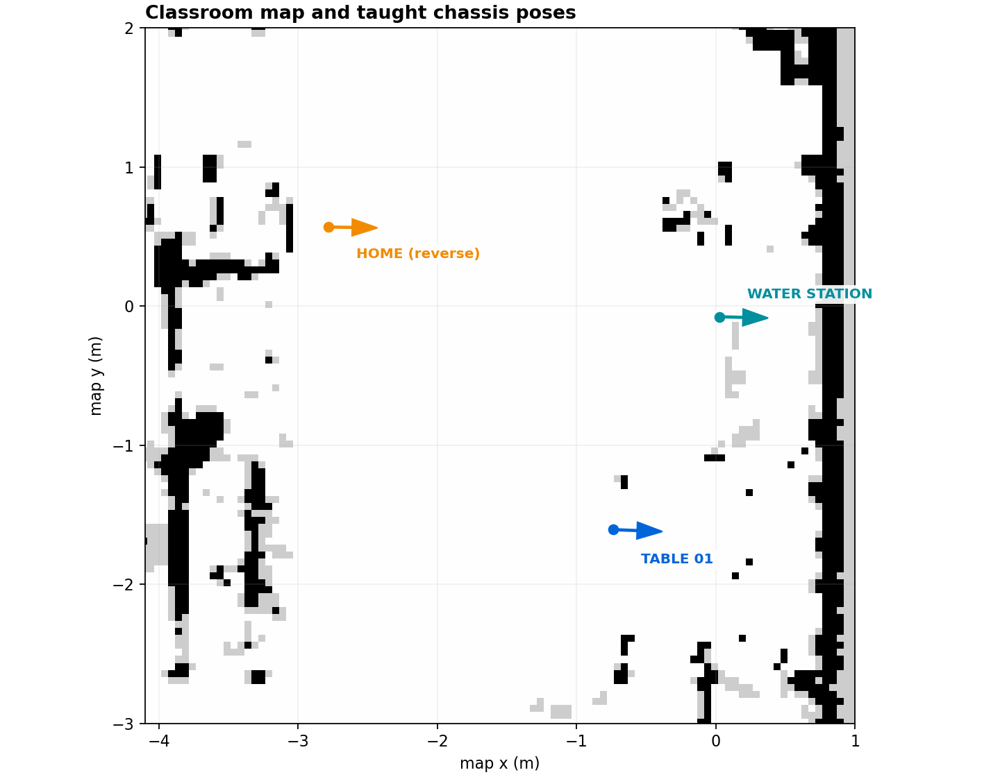

# 강의실 지도와 목적지 인계

이 폴더에는 2026-10-26 수동 SLAM 지도와 2026-10-27 테이블 주변 관측을 반영한
지도, 도크·급수대·1번 테이블의 등록 위치가 들어 있다. 아래 그림은 지도 일부와 세
지점을 표시한 미리보기다. 화살표는 차체 **앞 방향**을 가리킨다.



## 각 파일이 하는 일

| 파일 | 내용 |
| --- | --- |
| `map.yaml`, `map_table01_observed.pgm` | 저장 지도와 지도 이미지. 해상도는 5 cm/픽셀이고 원점은 `(-8.187, -4.964, 0)`이다. |
| `locations.yaml` | 도크와 목적지의 위치·방향. 운영 파일 `service_destinations.yaml`에서 지도 연결과 좌표를 복사해 상대경로로 만든 인계본이다. |
| `keepout.yaml`, `keepout.pgm` | 현재 지도에 연결된 진입 제한 마스크. 현재 버전은 미관측 영역만 대상으로 만들었다. |
| `route_waypoints.yaml` | 도크→급수대, 급수대→1번 테이블의 저장된 관측 경유점. 설명·시각화용이며 실행기 입력 파일이 아니다. |
| `face_search_regions.json` | 급수대와 1번 테이블 면의 예상 탐색 위치. 등록 차체 위치와 차체 앞쪽 길이에서 계산한 값이며 실측 면이 아니다. |
| `camera_mount_snapshot.yaml` | 당시 카메라 장착 변환값과 추정 근거. 이동 명령에 자동 적용되는 설정이 아니다. |
| `annotation.json`, `offline_view.rviz`, `restaurant_phase2.rviz` | 위치 마커와 RViz 표시 설정. `offline_view.rviz`는 센서가 없어도 볼 수 있는 화면이고 다른 파일은 당시 화면 설정이다. |
| `view.launch.py` | 저장 지도와 목적지 마커를 ROS 2에 발행하고 RViz를 여는 표시 전용 실행 파일이다. 속도·목적지 명령을 보내지 않는다. |

`location.yaml` 또는 `locations.yaml`은 ROS 2 전체에서 정해진 단일 표준 파일명이
아니다. 여기서는 팀원이 찾기 쉽도록 `locations.yaml`로 이름을 붙였고, 내용은 이
프로젝트의 목적지 등록 형식을 따른다. 지도 이미지와 그 위치를 지정하는 `map.yaml`,
ROS 네트워크를 구분하는 `ROS_DOMAIN_ID`, Wi-Fi 접속 정보는 각각 다른 것이다.

## 위치의 뜻

모든 위치는 이 폴더의 지도에 묶인 `map` 좌표계에서 차체의 `base_link` 위치와 방향이다.
좌표 단위는 m, 방향 `yaw` 단위는 rad다. 점은 책상이나 박스의 중심이 아니며,
`base_link`는 차체의 기하학적 중심이 아니라 실차 전륜축을 기준으로 한다.

| 지점 ID | x (m) | y (m) | yaw (rad) | 주차 방향 |
| --- | ---: | ---: | ---: | --- |
| `home_dock` | -2.780726 | 0.567876 | -0.016970 | 뒤쪽 박스를 보며 후진 |
| `water_station` | 0.024608 | -0.076957 | -0.025997 | 책상 면으로 전진 |
| `table_01` | -0.734910 | -1.606882 | -0.038410 | 책상 면으로 전진 |

전체 자릿수와 등록 근거는 `locations.yaml`에 있다. 도크 화살표도 차체의 앞쪽을
가리키므로 실제 후진 진입 방향은 화살표의 반대다. 책상 앞끝 목표 간격과 도크의
박스 기준 후면 간격은 각각 1 cm다. 급수대와 테이블의 좌우 허용오차 ±5 mm는
설정된 목표이며 실측으로 달성한 수치가 아니다. 새 지도·카메라·양팔 조립 상태의
최종 간격과 반복 정밀도는 아직 외부 실측으로 검증되지 않았다. 지도 해상도가
5 cm라고 해서 저장 좌표의 주행 도착 오차가 5 mm로 보장되는 것도 아니다.

`route_waypoints.yaml`의 관측 위치는 최종 주차점이 아니다. 지도는 낮은 2D 라이다가
본 장애물을 담으며, 높은 책상 상판과 양팔이 닿는 부분을 모두 나타내지 못한다.
이 마스크는 테이블 상판의 전체 면적을 추정해 제한하지 않는다.

## 컴퓨터에서 지도만 보기

Ubuntu의 ROS 2 Jazzy, Nav2 map server·lifecycle manager, RViz2와 Python의
`numpy`, `yaml`이 필요하다. 로봇 연결은 필요 없다. 저장소를 내려받은 뒤 전달받은
브랜치로 전환하고 터미널에서 실행한다.

```bash
cd "$HOME/bimanual-robot"
source /opt/ros/jazzy/setup.bash
export ROS_DOMAIN_ID=42
export ROS_LOCALHOST_ONLY=0
export ROS_AUTOMATIC_DISCOVERY_RANGE=LOCALHOST
export FASTDDS_BUILTIN_TRANSPORTS=UDPv4
unset ROS_STATIC_PEERS
ros2 launch "$HOME/bimanual-robot/config/navigation/maps/classroom/view.launch.py"
```

지도와 위치 화살표가 표시되고 저장된 마스크도 표시용 토픽으로 발행된다. 검은색은
점유, 흰색은 비어 있는 공간, 회색은 미관측이다. 화면의
`HOME_REVERSE`, `WATER_STATION`, `TABLE_1`이
위 세 지점이다. 종료할 때 실행한 터미널에서 `Ctrl+C`를 누른다. 도메인 42는
이 PC에서 지도만 볼 때 운영 도메인과 섞이지 않도록 사용한 예시다.

## Pi와 연결해 현재 로봇 표시 보기

1. 노트북과 Pi를 서로 통신 가능한 현장 Wi-Fi에 연결한다. 2026-10-27 확인값은
   노트북의 연결 SSID `aicampus_286`, Pi 주소 `192.168.0.159`, 기존 노트북 주소
   `192.168.0.217`이다. Pi의 SSID는 확인하지 못했으며 IP 주소는 DHCP나 Wi-Fi
   변경으로 달라질 수 있다. Wi-Fi 비밀번호는 팀 내부에서 공유한다.
2. Pi의 로그인 계정은 현재 `lim`이다. Pi IP를 알고 있을 때 아래처럼 연결한다.
   비밀번호나 SSH 키는 GitHub에 올리지 않고 팀 내부에서 전달하거나 팀원의 공개키를
   Pi 계정에 등록한다.

   ```bash
   export JDAMR_HOST='lim@192.168.0.159'
   ssh "$JDAMR_HOST"
   ```

   Pi에서 `hostname -I`로 현재 IP를 확인할 수 있다. 노트북에서
   `ip -4 -br addr`로 주소를 확인하고, 네트워크가 달라지면 `JDAMR_HOST`를 바꾼다.
   비밀번호로 대화식 SSH 접속이 되더라도 아래 자동 중계는 `BatchMode`를 사용하므로
   **암호 입력 없이 SSH 키로 로그인할 수 있어야 한다**. 팀원 PC에서
   `ssh -o BatchMode=yes "$JDAMR_HOST" hostname`이 성공해야 중계할 수 있다.
3. 현재 Pi의 ROS 제어 그래프는 Jazzy, `ROS_DOMAIN_ID=12`,
   `ROS_AUTOMATIC_DISCOVERY_RANGE=LOCALHOST`, UDPv4 설정이다. Wi-Fi에 붙고
   도메인 번호를 같게 설정하는 것만으로 노트북이 Pi 토픽을 볼 수는 없다.
   같은 컴퓨터에서만 노드를 찾도록 되어 있기 때문이다. PC는 SSH 표시 중계를 쓴다.
   자세한 원리는 [ROS 2의 discovery 설정](https://github.com/ros2/ros2_documentation/blob/rolling/source/Developer-Tools/Introspection-and-analysis/Improved-Dynamic-Discovery.rst)을 참고한다.
4. PC 터미널 하나에서 위 지도 보기 명령을 실행하되 `ROS_DOMAIN_ID=42` 대신
   `ROS_DOMAIN_ID=12`를 사용한다. 운영 중인 PC에 이미 같은 `/map` 표시 서버가
   떠 있다면 중복 실행하지 않고 기존 화면을 사용한다.
5. 다른 PC 터미널에서 아래 표시 중계를 실행한다. Pi의 `$HOME/jdamr_ws/install`에
   현재 ROS 빌드가 있고 Pi 측 센서·TF가 실행 중이어야 한다.

   ```bash
   cd "$HOME/bimanual-robot"
   source /opt/ros/jazzy/setup.bash
   export JDAMR_HOST='lim@192.168.0.159'
   export PYTHONPATH="$HOME/bimanual-robot/src/navigation/jdamr_cube_navigation:${PYTHONPATH:-}"
   PI_WORKSPACE="$(ssh -o BatchMode=yes "$JDAMR_HOST" 'printf "%s/jdamr_ws" "$HOME"')"
   python3 -m jdamr_cube_navigation.rviz_display_relay import \
     --host "$JDAMR_HOST" --workspace "$PI_WORKSPACE"
   ```

   RViz에서 `Live LiDAR`, `Current Robot`, `Nav2 Planned Path` 항목을 켜면 해당
   데이터가 있을 때 함께 표시된다. 중계는 표시 토픽만 전달하며 지도는 앞 단계의
   PC map server가 제공한다. 사용 후 두 터미널을 각각 `Ctrl+C`로 종료한다.
   SSH 접속과 중계가 되더라도 지도 정합·센서 보정·주행 준비가 검증된 것은 아니다.

## 실제 운영본과의 관계

이 묶음은 **지도와 좌표를 확인하기 위한 시점 고정 인계본**이다. 로봇의 현재 지도
선택 포인터, 실행 상태, 도크 라이다 기준 스캔, 급수대 RGB-D 기준 영상, station
프로파일과 실행 로그는 포함하지 않았다. 따라서 이 폴더만 복사했다고 전체
주행·정밀 주차를 재현할 수 있는 것은 아니다. Pi에서 실제 운행에 사용할 때는
[주행 통합 사용법](../../../../docs/guides/JDAMR_RUNTIME.md)과
[운영 도구 설명](../../../../tools/jdamr/README.md)의 실행 자산 및 보정을 함께 준비한다.
`locations.yaml`을 Pi 운영 파일에 덮어쓰거나 도크 기준을 새로 등록하지 않는다.

지도는 정리와 테이블 주변 관측이 반영된 PGM 결과물이다. 연속 SLAM용 원본
Cartographer `.pbstream`은 포함하지 않았고, 이전 원본을 열어도 이 PGM 후처리
결과가 그대로 복원된다고 볼 수 없다. 다른 공간으로 테이블을 옮기거나 새 지도를
만들면 기존 목적지 좌표를 그대로 재사용하지 않고 해당 지도 기준으로 다시 등록한다.

지도 YAML SHA-256은
`fe44094511fd906a733a3cb295ba7d0262a15e8571cb210cc7da880b711eb81e`,
지도 이미지 SHA-256은
`038b49f8d9287210c218e8880c38d57db256e949fa36506f37365839d9ca7862`다.
