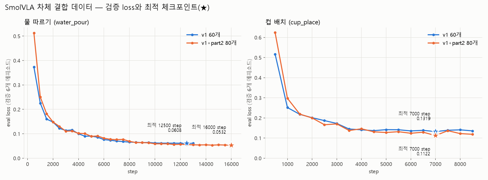
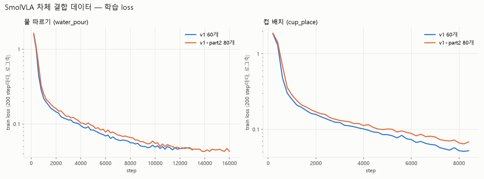

# 차체 결합 데이터 SmolVLA 학습 — 60개 vs 80개, 4개 모델 (실험 기록)

최초 작성 2026-10-26 · 조작(IL) 담당자 작성 · 학습 2026-10-25 10:16 ~ 20:26 (원격 RTX 4090)

## 0. 한 줄 요약

차체 결합 데이터로 SmolVLA 4개(2 task × 데이터 60개/80개)를 학습했다. 같은 검증 에피소드 6개로 비교한 결과, **80개 모델이 두 task 모두 eval loss가 더 낮았다** (물따르기 −12.5%, 컵배치 −15%). 실기체에서는 SmolVLA가 "굉장히 잘 동작"하는 것을 사용자가 확인했다.

- 모델별 실기체 성공률은 아직 정량 측정하지 않았다.
- 60개 모델과 80개 모델을 실기체로 비교한 기록도 아직 없다.

| 모델 | 데이터 | 최적 step | 최적 eval loss | 종료 | HF (private) |
|---|---|---|---|---|---|
| 물따르기 60 | v1 60개 | 12500 | 0.0608 | 13000/13000 (끝까지) | `jun-seo/water_pour_chassis_smolvla_60_12500S` |
| 컵배치 60 | v1 60개 | 7000 | 0.1319 | 8500/14500 (조기 종료) | `jun-seo/cup_place_chassis_smolvla_60_7000S` |
| 물따르기 80 | part2+v1 80개 | 16000 | **0.0532** | 16000/17500 (조기 종료) | `jun-seo/water_pour_chassis_smolvla_80_16000S` |
| 컵배치 80 | part2+v1 80개 | 7000 | **0.1122** | 8500/19500 (조기 종료) | `jun-seo/cup_place_chassis_smolvla_80_7000S` |

---

## 1. 설정 — 검증된 v2 설정에서 두 가지만 바꿈

사용자 요청은 "무작정 다 넣지 말고, 최대 성능을 낼 조합으로"였다. 그래서 실기체에서 검증된 v2 설정을 그대로 두고, 근거가 분명한 두 가지만 바꿨다.

**v2와 같은 것**
- batch 8
- 학습률 1e-4와 기본 스케줄
- 비전 인코더 동결 해제, 전체 학습(`train_expert_only=false`)
- 500 step마다 저장과 eval
- 조기 종료 `EVAL_PATIENCE=3`, `EVAL_MIN_DELTA=1e-4`
- 최적 = eval loss 최솟값

**바꾼 것**
1. **최대 step을 데이터 양에 비례해 늘렸다.** v2는 물따르기 74,751프레임·컵배치 31,481프레임에 10,000 step이었다. 같은 비율로 물따르기 13000/17500, 컵배치 14500/19500 step을 잡았다. step이 30000보다 적으면 학습률 decay 길이도 step 수에 맞춰 자동으로 줄어든다.
2. **이미지 증강을 켰다** (`--dataset.image_transforms.enable=true`, lerobot 기본값).
   - 내용: 밝기·대비·채도·색조·선명도 변화와 ±5° 회전, ±5% 이동 가운데 샘플마다 최대 3개를 적용한다.
   - 범위: 학습셋에만 적용하고 eval셋에는 적용하지 않는다.
   - 이유: 브리지가 재연결될 때마다 노출이 다르게 잡혔다. top 카메라 방향도 어긋났고(약 17px), 왼쪽 손목캠 기종도 바뀌었다(→ [카메라 기록](20261023_차체결합후_카메라_재구성_뎁스플리커_정렬.md)).

**이미지 증강은 데이터를 늘리는 게 아니다**
- 학습에 쓰는 건 우리가 모은 에피소드뿐이다. 80개 모델은 학습 74개와 검증 6개, 60개 모델은 학습 54개와 검증 6개다. 변형한 이미지로 새 에피소드를 만들어 저장하지 않는다.
- 학습 중 batch를 만들 때마다, 꺼낸 프레임의 **카메라 이미지에만** 무작위 변형을 건다. 그 batch에만 쓰고 버린다. 같은 프레임이 다시 나오면 다른 무작위 변형이 걸린다.
- **관절값과 행동(정답)은 바꾸지 않는다.** "이 화면이면 이렇게 움직인다"는 정답은 시연 그대로다.
- step 수와 batch 크기는 증강이 없을 때와 같다. 즉 학습량은 같고, 같은 장면을 매번 조명·각도가 살짝 다르게 볼 뿐이다.
- 검증 6개는 증강 없이 원본으로 평가한다.
- 이전 v2 SmolVLA는 증강 없이 학습했다. 이번 차체 결합 모델부터 켰다.

**일부러 넣지 않은 것:** 학습률·batch 변경과 모델 키우기. 검증 없이 한꺼번에 바꾸면 오히려 나빠질 위험이 있다.

**검증 분할**
- 60개 모델: eval_split 0.1 → 54개로 학습, 6개로 검증
- 80개 모델: eval_split 0.07 → 74개로 학습, 6개로 검증
- 80개 데이터는 part2 → v1 순서로 붙였다. 그래서 두 모델 모두 v1의 54~59번으로 검증한다(→ [데이터 기록](20261023_차체결합_데이터수집_레포구성과_에피소드정리.md) 4절).

**재현용 파일**
- [`tools/training/chain_smolvla_chassis.sh`](../../tools/training/chain_smolvla_chassis.sh): 4개 순차 학습과 최적 체크포인트 HF 업로드
- [`tools/training/make_loss_report.py`](../../tools/training/make_loss_report.py): 로그에서 loss CSV와 그래프 생성
- 조기 종료 패치: [`tools/recording/lerobot_train_earlystop_port.patch`](../../tools/recording/lerobot_train_earlystop_port.patch)

## 2. 관찰
1. **물따르기는 길게 학습할수록 계속 좋아졌다.**
   - 60개 모델은 조기 종료 없이 끝까지 돌았다. 끝에서는 학습률이 거의 0이라 개선 폭이 작았다(12000→12500에서 0.0004).
   - 80개 모델은 16000에서 멈췄다. 직전 최저값(14500의 0.0533)보다 정확히 1e-4만 좋아져서 "개선 없음"으로 셌기 때문이다. 이때도 최저값이 마지막 체크포인트라 손해는 없다.
2. **컵배치는 두 모델 모두 7000에서 최적이었고 8500에서 멈췄다.**
   - 4500 이후로는 eval loss가 ±0.01 안에서 오르내렸다. 그래서 "정확히 7000이 최적"이라기보다 "4500~8000이면 비슷하다"로 읽는 게 맞다.
   - 이 구간에서 80개 모델이 거의 항상 아래에 있었다.
3. **train loss는 80개 모델이 약간 높고 eval loss는 더 낮다.** 같은 step에서 처음 보는 프레임이 더 많기 때문이다. 과적합이 덜하다는 신호다.
4. **v2 모델과의 숫자 비교는 참고만 한다.** v2는 물따르기 0.072, 컵배치 0.146이었지만 검증 에피소드와 환경(차체 결합, 카메라)이 다르다.
5. 처음에 증강 없이 시작한 버전은 약 15분 만에 멈췄다. 그래서 증강 유무를 직접 비교한 결과는 없다.

## 3. 확인하다 발견한 것 — 사전학습 없이 처음부터 학습됐다

- 이번 4개와 v2 SmolVLA는 `--policy.type=smolvla`로 실행했다. 그래서 학습 설정이 `pretrained_path=None`, `load_vlm_weights=False`였다.
- 로그에도 SmolVLM2 가중치를 불러온 기록이 없다. 즉 **SmolVLM2 사전학습 가중치 없이 랜덤 초기화에서 학습**됐다(학습 파라미터 393M / 전체 450M).
- 그런데도 실기체에서 잘 동작했다. 좁은 작업 하나에 대해서는 데이터 60~80개로도 충분했다는 뜻이다.
- `--policy.path=lerobot/smolvla_base`에서 시작하면 더 좋아질 여지가 있다. 아직 비교하지 않았다.
- 이전 pi0 학습도 같은 문제가 있었다(→ [pi0 기록](20261026_pi0_차체결합_학습_가능성검토와_실행.md)).

## 4. 추론 명령어
기존 명령에서 `--policy.path`만 바꾸면 된다.
- 경로: `C:\Users\USER\lerobot-training\outputs\<모델명>\checkpoints\<step 6자리>\pretrained_model`
- PC에 받은 체크포인트는 `policy_preprocessor.json`의 `tokenizer_name`을 절대경로로 고쳐 뒀다. 원본은 `.bak`으로 남겼다.
- task 문자열은 데이터셋의 `meta/tasks.parquet`과 글자 단위까지 같다.
- 시작 자세와 끝 자세 맞추기는 [롤아웃 자세 가이드](../guides/20261026_롤아웃_시작끝_자세_저장_가이드.md)에 정리했다.

**`--end.auto=pour` 주의**
- 작업 끝 판정 기준 자세(`CHASSIS_HOLD`)는 v2(테이블 거치) 데이터의 평균이다.
- 차체 결합 데이터의 물따르기 끝 자세는 왼팔 shoulder_lift가 평균 9.0° 낮다(표준편차 6.6°). 기본 허용치 10°에 자주 걸려서 자동 종료가 안 될 수 있다.
- 안 걸려도 duration이 끝나면 그 자리에 멈추니 안전 문제는 아니다.
- 바로 끝나게 하려면 `--end.tol=15`를 붙인다.
- 컵배치 판정에 쓰는 `POUR_START`는 새 데이터와 2° 안에서 맞는다.

## 5. 남은 일
- 60개 모델과 80개 모델의 실기체 성공률을 같은 조건(위치 격자·반복 횟수)으로 측정한다.
- `smolvla_base`에서 시작하는 버전을 학습해 비교한다.
- 이미지 증강의 효과(조명·카메라 변화에 대한 강건성)를 실기체로 확인한다. eval loss에는 거의 드러나지 않는다.
